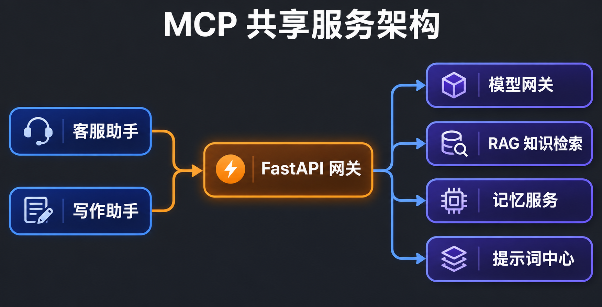

# MCP 多项目共享服务

**两套应用共用一套 Agent 能力，网关集中处理调用与项目配额。**

客服助手和写作助手有各自的业务流程，检索、会话记忆、提示词和模型调用却可以复用。仓库展示如何用 MCP 把这些能力做成独立服务，再通过一个 HTTP 网关暴露给应用。

## 架构怎么跑

| 层 | 实现 |
|---|---|
| 应用层 | 客服助手与写作助手通过各自的网关客户端调用共享能力。 |
| FastAPI 网关 | 为项目提供工具列表、工具调用、提示词查询和配额查询。认证与项目身份在网关处理，模型调用可记录用量。 |
| MCP 接入层 | 连接管理器维护到各 MCP 服务的连接，按请求选择目标服务。 |
| 共享服务 | 模型网关、RAG 知识检索、记忆服务和提示词中心各自封装接口和实现。 |

**设计取舍**：应用侧走统一 HTTP 接口，网关侧负责 MCP 连接和路由。新的应用可以复用现有服务，服务的内部实现也能独立调整。

## 一次工具调用如何穿过网关

1. **业务应用发起请求**。客服和写作助手各自保留流程逻辑，经 HTTP 调用网关接口，应用无需分别管理多个 MCP 连接。
2. **网关识别项目**。认证中间件解析请求身份，配额中间件在应用调用共享服务前检查项目额度。
3. **调用目标服务**。路由将工具请求交给 MCP 连接管理器，后者调用目标服务并返回结果。模型响应返回用量时，网关将其归入对应项目。
4. **业务应用消费结果**。应用继续按自己的提示词、检索或记忆需求组织响应。共享服务以独立模块提供能力，业务调用和服务实现可分别修改。

## 网关暴露的接口

| 接口 | 作用 |
|---|---|
| `POST /api/tool/list`、`POST /api/tool/call` | 查询和执行服务工具 |
| `GET /api/prompt/list`、`POST /api/prompt/get` | 查询提示词及获取模板 |
| `GET /api/health`、`GET /api/quota/usage` | 查看网关状态及当前项目用量 |

服务和项目配置见 [gateway/config.yaml](gateway/config.yaml)。仓库提供 [网关检查脚本](scripts/test_gateway.py)及 [RAG 检查脚本](scripts/test_rag_service.py)，可分别检查接入层和具体服务。

## 源码入口

- [网关路由](gateway/router.py)和[MCP 连接管理](gateway/mcp_client_manager.py)
- [共享服务](shared/)与[应用入口](projects/)
- [启动和连通性测试](scripts/)

## 本地启动

使用 Python 3.11+ 和 uv。复制 `.env.example` 为 `.env` 并填写模型配置，执行 `uv sync`，再用 `uv run scripts/start_all.py` 启动网关和服务。

项目基于课程示例代码。
